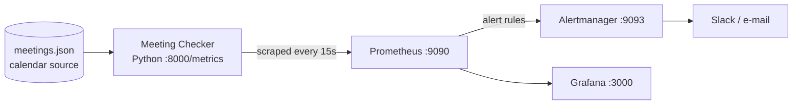

# Meeting Checker

SRE Academy final project. Meeting Checker monitors calendar meetings and reports, as Prometheus metrics:

- which meetings **have a room** and which are **missing one** (online-only meetings are excluded)
- which meetings are **starting within 24h with no room** (urgent)
- which meetings have **attendees who have not responded (RSVP)**

Prometheus scrapes the metrics, Grafana shows them, and Alertmanager sends alerts to Slack.

## Architecture



Everything runs in the `meeting-checker` Kubernetes namespace. Prometheus finds the app through **Kubernetes service discovery**
(pods annotated `prometheus.io/scrape: "true"`).

## Requirement checklist

| # | Requirement | Where |
|---|---|---|
| 1 | Application emitting metrics | [`app/`](app) (Python + `prometheus_client`) |
| 2 | Kubernetes deployment | [`k8s/`](k8s) |
| 3 | Prometheus scraping | [`k8s/prometheus/`](k8s/prometheus) |
| 4 | Grafana dashboard | [`k8s/grafana/`](k8s/grafana) (auto-provisioned) |
| 5 | Alertmanager | [`k8s/alertmanager/`](k8s/alertmanager) |
| 6 | Documentation | this README, [LICENSE.md](LICENSE.md), [CONTRIBUTING.md](CONTRIBUTING.md), `docs/screenshots/` |
| Bonus | Slack notifications | `k8s/alertmanager/alertmanager.yml` |
| Bonus | Infrastructure as Code | Kustomize (`k8s/kustomization.yaml`) |
| Bonus | CI/CD | GitHub Actions (`.github/workflows/ci.yml`) |

## Metrics

| Metric | Meaning |
|---|---|
| `meetings_total` | Upcoming meetings in the look-ahead window |
| `meetings_with_room` | In-person meetings with a room |
| `meetings_missing_room` | In-person meetings without a room |
| `meetings_urgent_missing_room` | ...of which start within `URGENT_HOURS` |
| `meetings_online` | Online-only meetings (no room needed) |
| `meetings_missing_rsvp` | Meetings with at least one pending attendee |
| `attendees_pending_rsvp` | Total attendees who have not responded |
| `meeting_checker_last_success_timestamp_seconds` | Last successful check |
| `meeting_checker_errors_total` | Failed checks |

## Alerts

| Alert | Severity | Condition |
|---|---|---|
| MeetingCheckerDown | critical | Target not scrapeable for 1m |
| MeetingStartingSoonWithoutRoom | critical | Any meeting < 24h away with no room |
| MeetingsMissingRoom | warning | Any meeting without a room for 5m |
| ManyPendingRSVPs | warning | More than 5 attendees pending for 5m |
| MeetingCheckerCalendarErrors | warning | Check errors in the last 5m |
| MeetingCheckerStale | warning | No successful check for 5m |

## Run locally (no Kubernetes)

```bash
pip install -r app/requirements.txt
python -m unittest discover -s tests -v
cd app && python main.py        # metrics at http://localhost:8000/metrics
```

The demo calendar is `app/data/meetings.json`. Times are "hours from now", so there are always upcoming meetings.
Edit the file (e.g. set `"room": "Room B"`) and the metrics change on the next check (every 30s).

## Deploy to Kubernetes

Prerequisites: Docker, kubectl, and a cluster (Docker Desktop Kubernetes, Minikube, kind, or a cloud cluster).

```bash
# 1. Build the image (Minikube: run `minikube image load meeting-checker:1.0.0` afterwards;
#    kind: `kind load docker-image meeting-checker:1.0.0`; Docker Desktop: nothing more needed)
docker build -t meeting-checker:1.0.0 app

# 2. Deploy the whole stack (namespace, app, Prometheus, Alertmanager, Grafana)
kubectl apply -k k8s/

# 3. Check everything is running
kubectl -n meeting-checker get pods

# 4. Open the UIs (each in its own terminal)
kubectl -n meeting-checker port-forward svc/grafana 3000:3000        # admin / admin
kubectl -n meeting-checker port-forward svc/prometheus 9090:9090
kubectl -n meeting-checker port-forward svc/alertmanager 9093:9093
```

Grafana opens with the **Meeting Checker** dashboard already provisioned and Prometheus preconfigured as the datasource.

> If local port 9090 is already in use, forward to another one, e.g. `port-forward svc/prometheus 19090:9090`.

**kind (used for the reference deployment):** `kind create cluster --name meeting-checker`, then
`kind load docker-image meeting-checker:1.0.0 --name meeting-checker` before `kubectl apply -k k8s/`.

### Slack notifications (bonus)

1. Create a Slack *Incoming Webhook* and note its URL.
2. Replace the placeholder secret (do **not** commit the real URL):
   ```bash
   kubectl -n meeting-checker create secret generic alertmanager-secrets \
     --from-literal=slack-webhook-url='https://hooks.slack.com/services/XXX/YYY/ZZZ' \
     --from-literal=smtp-password='unused' --dry-run=client -o yaml | kubectl apply -f -
   kubectl -n meeting-checker rollout restart deploy/alertmanager
   ```
3. An e-mail receiver template is included (commented out) in `k8s/alertmanager/alertmanager.yml`.

### Trigger an alert (demo)

The demo data already has a meeting without a room starting in 5 hours, so `MeetingStartingSoonWithoutRoom` fires about 1 minute
after startup. To see it resolve, assign a room to meeting `m2` in `app/data/meetings.json`, rebuild the image and restart the pod.
To fire `MeetingCheckerDown`: `kubectl -n meeting-checker scale deploy/meeting-checker --replicas=0`.

## Using a real calendar

`app/sources.py` defines the `CalendarSource` interface (`fetch() -> list[Meeting]`). Add a Microsoft Graph or Google Calendar
implementation and select it in `app/main.py`. The checking logic in `app/checker.py` does not change.

## CI/CD

`.github/workflows/ci.yml` runs on every push and pull request: unit tests, `promtool check rules`, `amtool check-config`,
`kubectl kustomize`, then builds the Docker image (and pushes it to GHCR on `main`).

## Screenshots (evidence)

Save these in `docs/screenshots/` and link them here:

1. `kubectl -n meeting-checker get pods` (all Running)
2. Prometheus **Status > Targets** (meeting-checker UP)
3. Prometheus **Alerts** page (a firing alert)
4. Grafana **Meeting Checker** dashboard
5. Alertmanager UI with an active alert
6. The Slack message (if configured)
7. GitHub Actions run (green)

## Project layout

```
app/          Python application, Dockerfile, demo data
k8s/          Kubernetes manifests (Kustomize): app, prometheus, alertmanager, grafana
tests/        Unit tests
.github/      CI/CD workflow
```

## License

[MIT](LICENSE.md). See [CONTRIBUTING.md](CONTRIBUTING.md) to contribute.
